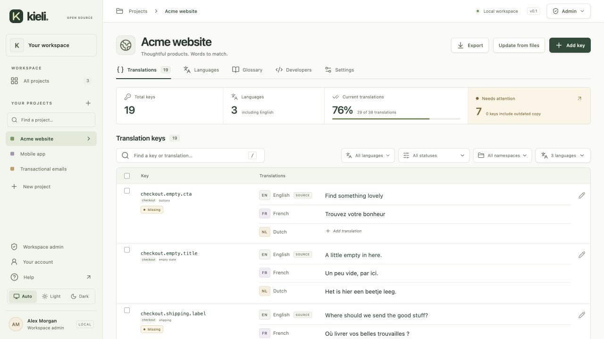
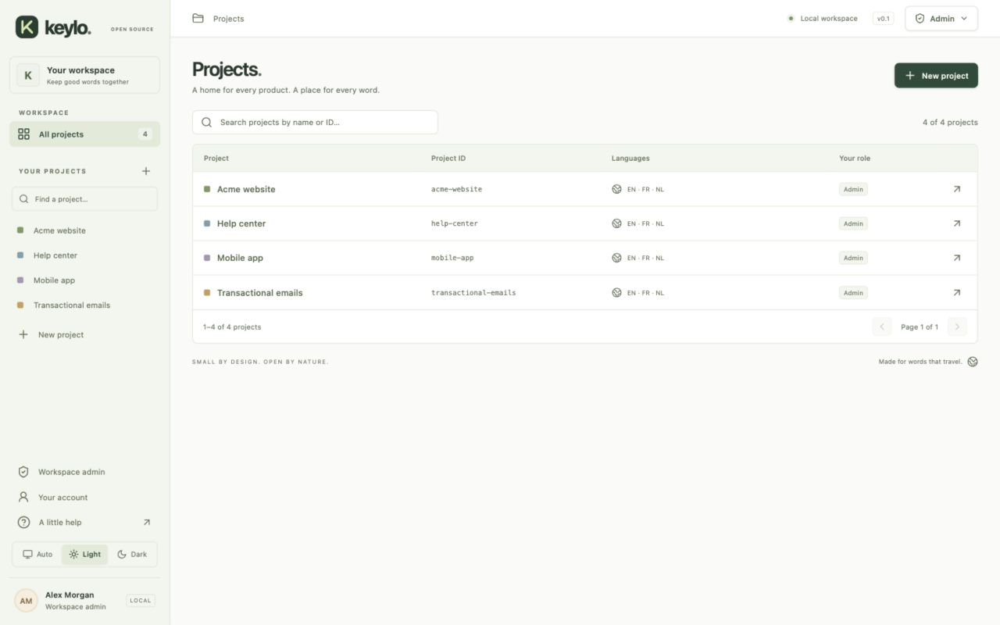
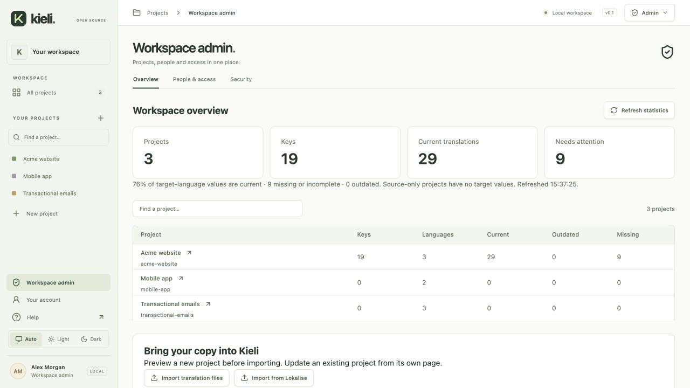

<div align="center">

# Keylo

### Good words. Every language. Your infrastructure.

An open-source workspace for product copy and translations.<br />Keep your keys organized, your translations current, and your releases moving.

[Get started](#get-started) · [Features](#a-focused-home-for-your-copy) · [Security](#built-for-control) · [Documentation](#documentation)

**Self-hosted · MIT licensed · Built-in accounts or SSO**

</div>



## A focused home for your copy

Keylo gives product teams and developers a shared place to manage the words in their apps. Organize separate projects, work in several languages, and ship localization files through your existing build pipeline. The interface stays compact as your project directory and key lists grow.

### Keep every language in view

- **Project-based organization.** Source and target languages, namespaces, context and tags keep copy easy to find.
- **Archive retired projects.** Hide projects from default navigation and make them read-only while retaining history, settings and existing exports. Managers can [restore archived projects](docs/project-archive.md).
- **Reuse previous wording.** Find [exact source matches in project history](docs/translation-memory.md), inspect their origin and apply them to a draft before saving.
- **Consistent terminology.** Maintain a [shared project glossary](docs/glossary.md), consult matching terms beside copy, and bring terminology to Claude through scoped MCP access.
- **A purposeful editor.** Stacked language values, search, locale filters and cursor pagination help you work through thousands of keys. [Save & next, keyboard navigation and guarded drafts](docs/editor-navigation.md) keep you moving across pages.
- **Translation freshness.** See what is missing, current or outdated when source copy changes. Existing translations stay available for editing.
- **Plurals and linked copy.** Unicode cardinal/ordinal forms, project-level overrides and reusable `[%key:other.key%]` references.
- **Safer changes.** Argument checks, version conflicts, per-translation history, recoverable key deletion and project snapshots help protect your work.
- **Rename keys safely.** Preview linked keys, update references together, and retain translations, freshness and history. [Key renaming](docs/key-renaming.md).



### Fit your development workflow

- **Bring existing copy.** Import Lokalise exports or supported localization files. Preview updates to existing projects and preserve populated translations by default.
- **Use your app's formats.** JSON, YAML, JS/TS, PHP, properties, INI, RESX, keyed PO/POT, Apple strings/plist and [native plural dictionaries](docs/apple-stringsdict.md), Android XML, ARB, XLIFF and CSV. See [supported subsets and limits](docs/file-formats.md).
- **Sync through CLI and CI.** Pull translation files or push source strings with separate scoped credentials. Use `--require-current` to stop a build when copy is missing, outdated or invalid.
- **Connect Claude Code.** An optional MCP connection lets your Claude client read a project's context and save translations in selected target languages, with explicit overwrite permission.
- **Deliver mobile copy updates.** Publish immutable releases for iOS, Android and Flutter, with channels, rollback and offline fallback. [Mobile SDKs and delivery](docs/ota.md).

Keylo keeps the workflow small: manual editing and explicit publication, without translation-review stages or a built-in automatic translation service.

## Built for control

**Keep your copy on your infrastructure.** Keylo is designed for a self-hosted organizational workspace, with project access enforced by the backend.

- **Choose how people sign in:** built-in email/password accounts, Okta OIDC or SAML SSO with optional signed Single Logout.
- **Manage access centrally:** workspace administration, project roles, account disabling and revocable server-side sessions. SSO supports SCIM provisioning and optional Okta reconciliation.
- **Scope integrations:** separate export, source-sync, MCP and mobile delivery credentials. Management capabilities stay behind administrator access.
- **Protect changes:** atomic write batches, optimistic concurrency, placeholder validation and security audit events.
- **Recover your work:** translation history, 30-day recoverable key deletion, and manual or scheduled project snapshots.



The [security model](SECURITY.md) documents credential lifecycles, trust boundaries and current limitations. [SAML Single Logout](docs/saml.md#single-logout) supports provider sign-out and verified IdP-initiated session revocation when configured; local-only sign-out remains available. Local tests are not an independent security audit, and real IdP/AWS integrations need staging verification.

## Get started

Try the local demo with **Node.js 24.2 or newer**. No AWS or Okta account is required.

```sh
npm ci
npm run seed # optional sample projects; omit for an empty workspace
npm run dev
```

Open the printed local URL. The demo runs only on loopback outside production; SQLite data persists in `.data/keylo.sqlite`.

For your team, enable **built-in accounts** or **SSO**, set `APP_ORIGIN`, and follow the relevant setup guide. Production requires HTTPS and rejects demo authentication.

| Deployment | What you need |
| --- | --- |
| Local development | Node.js and SQLite, included with Node |
| Container | The included Docker image and your authentication configuration |
| AWS | Lambda, HTTP API Gateway and DynamoDB, using the included templates |

A guided AWS installer and first-administrator setup are implemented. **No public install button is published yet:** release hosting needs an AWS account and artifact bucket. [AWS installation and upgrades](docs/aws-one-click.md).

### Pull translations into your app

Create an export token in **Project → Developers**, then store it as `KEYLO_TOKEN` in your shell or CI secrets.

```sh
node cli/keylo.mjs pull \
  --url https://copy.example.com \
  --project acme-website \
  --languages en,fr,nl \
  --format nested \
  --out ./src/locales \
  --require-current
```

The terminal CLI adds Kip, a small original key character, clear progress stages and a concise summary. CI and piped output stay plain; use `--plain` or `--no-color` to choose your style. Run `node cli/keylo.mjs --help` to explore.

The standalone CLI uses Node built-ins and writes individual locale files. [Source push and repository configuration](docs/source-sync.md) use a separate source-sync credential.

## Documentation

| Work with Keylo | Operate Keylo |
| --- | --- |
| [Imports and file formats](docs/file-formats.md) | [Built-in accounts and recovery](docs/built-in-accounts.md) |
| [Migrating from Lokalise](docs/lokalise-import.md) | [Okta OIDC](docs/okta.md) · [SAML](docs/saml.md) |
| [Updating existing projects](docs/project-updates.md) | [Provisioning and offboarding](docs/sso-lifecycle.md) |
| [Editor navigation and shortcuts](docs/editor-navigation.md) | [Workspace administration](docs/workspace-admin.md) |
| [Plurals, references and validation](docs/messages.md) | [Workspace administration](docs/workspace-admin.md) |
| [Translation history and recovery](docs/translation-history.md) | [Snapshots and recovery](docs/project-history.md) |
| [CLI and source sync](docs/source-sync.md) | [AWS deployment](docs/aws.md) |
| [Claude Code MCP](docs/mcp.md) | [Architecture and API](docs/architecture.md) |
| [Mobile delivery](docs/ota.md) · [SDKs](sdks/README.md) | [Security and vulnerability reporting](SECURITY.md) |

The frontend uses Astro and React, with a small TypeScript service layer and SQLite or DynamoDB storage. See [.env.example](.env.example) for configuration.

## Contribute

Read [COLLABORATING.md](COLLABORATING.md) for development setup and contribution checks. [AGENTS.md](AGENTS.md) gives coding agents repository guidance; GitHub issue forms and a PR template help keep changes reviewable.

```sh
npm run check
npm test
npm run build
npm run smoke
```

See the [next essentials](docs/roadmap.md) for the implementation sequence. Keylo is released under the [MIT license](LICENSE).

*Screenshots use synthetic demonstration projects.*
