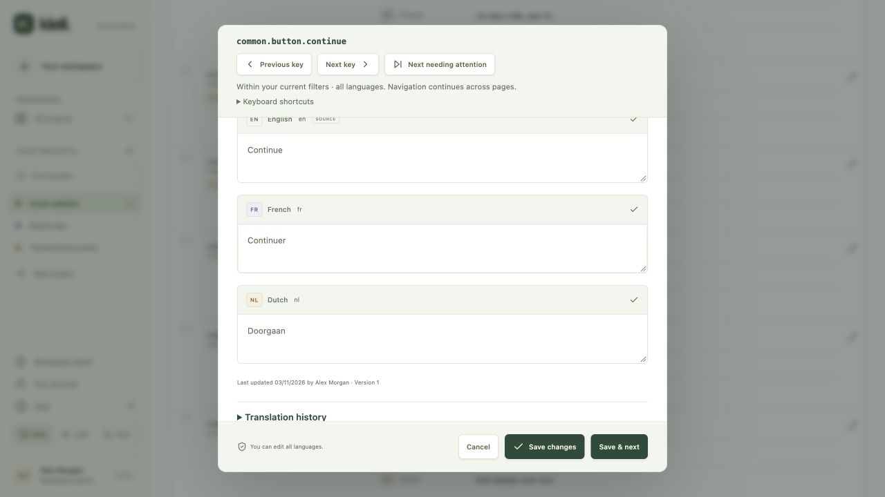

# Editor navigation

Open a key name or its pencil action to work through a filtered queue in the full editor without returning to the table after every change. Clicking ordinary translation copy starts [inline editing](inline-editing.md) for quick one-locale changes; plurals and linked keys use the full editor.

- **Previous key / Next key** move in key-name order across database pages.
- **Next needing attention** finds the next missing, incomplete or outdated key within the same filters. It does not wrap to the start. A Current-only filter has no attention matches.
- **Save & next** saves the draft with the existing version/source-context checks, then opens the next matching key. A saved key may leave the result, such as when filling a missing translation. Navigation uses its name as an anchor rather than an old row index.
- **Save changes** saves and returns to the list. Closing the editor restores its original list cursor, filters and scroll position. Focus returns to the opener when it still exists, or the list heading when the row has left the result.

Search, namespace, completion status and **Focus language** are captured when the editor opens. Focus language controls which locale is checked by completion/status filters and which translation field receives focus. Search continues to cover all key names, context, tags and copy; the visible-language chooser still controls the table's displayed languages. Other locales remain editable in the form.

Clicking a locale's copy (including an empty translation or plural preview) opens the editor at that language, overriding the default field focus without changing the list filters or saved preferences. This editing language stays focused when navigating between keys. Clicking a key name or its general edit button uses the list's Focus language, or the first target language when All languages is selected. A source field that you cannot edit is brought into view without enabling it.

The current key name, navigation controls and save actions stay visible while scrolling through many languages. `dir="auto"` is preserved for translation fields, including plural forms and right-to-left copy.

## Shortcuts and drafts

Expand **Keyboard shortcuts** inside the editor to see:

| Shortcut | Action |
| --- | --- |
| Alt + Left Arrow | Previous matching key |
| Alt + Right Arrow | Next matching key |
| Alt + N | Next matching key needing attention |

Navigation shortcuts run only outside inputs, textareas, selects and editable text. Use Tab to reach controls. Ordinary typing, cursor movement and plural entry keep their normal behavior. Native buttons support keyboard activation.

Moving, reloading or closing with unsaved changes asks whether to keep editing or discard the draft. Browser back/forward is guarded too. Page reload/tab close uses the browser's native unsaved-change warning when supported. Draft copy is held only in memory; it is not an autosave or persistent offline draft.

A failed save keeps the draft. A concurrency conflict offers **Load latest version**, with the same discard guard. If saving succeeds but opening the next key fails, the saved copy stays saved and the editor reports the navigation failure. No matching neighbor leaves the current key open with a clear end-of-results message. Other users' edits can change the queue between requests; it is a live filtered view, not a frozen assignment list.

Preparing empty Unicode plural forms or normalizing their ICU serialization does not count as a user edit, save target values or accept outdated copy. Explicit freshness acceptance is still required when retaining an unchanged outdated translation.

## Personal preferences

The browser remembers completion status, focus-language code and row count (25/50/100). If a language is absent from the next project, that project uses All languages. Storage failure falls back to defaults. Preferences are browser-wide and may be shared by people using that browser profile.

Search strings, namespaces, project identifiers, translation copy, drafts and credentials are never written to these preferences. Search and namespace are retained in memory during editor navigation, not after a page reload.

## API and scale

Browser sessions can use `GET /api/projects/:id/keys/:name/navigation` with `direction=previous|next|attention`, `q`, `namespace`, `status` and optional `language`. The response contains `{ key: ... }` or `{ key: null }` at a boundary. A removed anchor can still locate a neighbor. Ordinary key listing also accepts `language` for locale-specific completion filtering.

Project roles remain enforced by the service. Export, MCP and source-sync credentials cannot use browser editor navigation. MCP key listing retains its own locale scope. Ordinary projects use database cursor queries in either direction; plural/reference projects use the existing derived-view cache. No new database or deployment component is required.

Local verification includes a synthetic workspace with 3,001 keys, six languages, RTL text, cross-page filtered saves, keyboard navigation, unsaved-draft guards and narrow layouts. DynamoDB/production workload limits still require staging checks for the expected project sizes.
