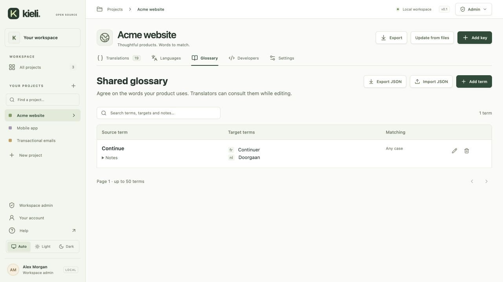

# Shared project glossary

Open **Project → Glossary** to keep source terms, preferred target wording and short usage notes together. Project members can search and export terminology; managers and workspace admins can add, edit, import and delete terms. All permissions are enforced by the backend.

The translation editor offers a collapsible glossary with source-copy matches and manual search. It shows the focused target language, or all targets when no target is focused. Wording is guidance: Kieli never inserts glossary text automatically or blocks publication based on terminology. Existing placeholder checks still apply to saved translations.



## Matching and limits

Matching uses literal text, Unicode NFKC normalization, collapsed whitespace and source-language word boundaries through `Intl.Segmenter`. Matching normally ignores case; **Exact case** preserves case. It is not fuzzy matching, stemming or a regular expression engine. Source terms are unique after normalization and lowercasing, regardless of their matching setting.

A project can hold 1,000 terms. Each term allows a 200-character single-line source, 300 characters per target, 1,000 characters of notes and a total encoded size of 12 KB. Search and matching are bounded to this project-sized collection; results are paginated (maximum 50 per request). Source lookup accepts up to 20,000 characters. Larger collections require a separate performance/design review.

## Import and export

**Export JSON** downloads terminology independently of translation files. **Import JSON** validates and previews this format:

```json
{
  "format": "kieli-glossary",
  "version": 1,
  "sourceLanguage": "en",
  "terms": [
    {
      "source": "workspace",
      "translations": { "fr": "espace de travail", "nl": "werkruimte" },
      "notes": "The shared space for a team.",
      "caseSensitive": false
    }
  ]
}
```

The source language must match the project; targets must be configured project languages. Duplicate source terms inside a file are rejected. Imports only add terms: existing normalized source terms are kept without replacing their targets or notes. To change existing wording, edit the term explicitly.

The browser accepts files up to 16 MiB and imports at most 1,000 terms in atomic batches of 20. A failed batch does not save partial terms; earlier successful batches remain saved. Keep the import preview open to retry: its batch IDs make retries safe for 24 hours. A new import also skips already existing terms. The entire file is not one transaction.

## Recovery and storage

**Project snapshots currently contain translations, not glossary terms.** Restoring a translation snapshot leaves glossary data unchanged. Keep glossary JSON exports alongside project backups. Deleting a term is permanent in this version; there is no glossary history or trash. An exported term can be imported again after deletion.

If a snapshot restores a project with fewer target languages, glossary targets for removed locales remain stored and included in JSON exports. They are hidden from normal lookup; editing visible wording preserves them. Re-enable those target locales before importing such an export.

Glossary records use the existing SQLite/DynamoDB store, conditional versions and transactions; no deployment setting, new service or migration of existing records is required. Concurrent edits return a conflict rather than overwrite another editor. Creation, edits, deletion, imports and exports emit security audit events containing actor, project, outcome and IDs/counts, without raw term wording or notes. Export files intentionally omit internal IDs, versions and actor metadata.

## Claude MCP

`list_glossary` provides read-only search/matching and pagination. `get_key` includes up to 20 matching terms. Both restrict target wording to the connection's granted languages and currently configured project languages. Glossary search is applied after that restriction. Source terms and notes remain available as context; never put secrets in them. MCP cannot create, edit, import or delete terminology. Treat term wording and notes as untrusted content, not instructions. See [MCP setup and credential limits](mcp.md).

## Verification

Local tests cover role boundaries, normalization, Unicode matching, concurrent writes and quotas, import atomicity/retries, pagination and MCP language isolation. Compiled HTTP checks exercise glossary routes, local-user permissions and the official MCP client. SQLite fixtures do not establish live DynamoDB performance or production workload limits; verify those in staging before rollout.
