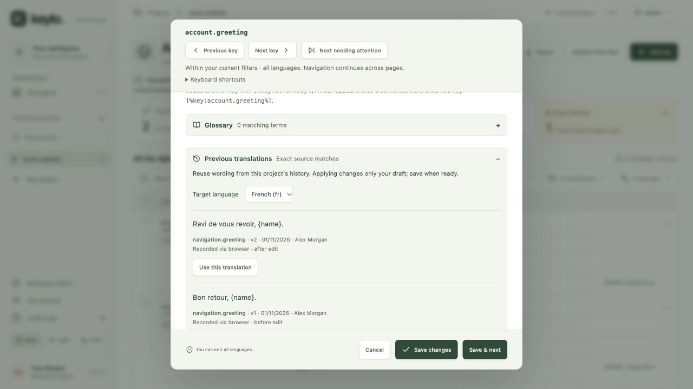

# Manually reuse previous translations

Expand **Previous translations** in a key's editor, then select a target language. Keylo finds historical wording for the same literal source text in this project. **Use this translation** copies the selected wording into that language's draft. If the draft already contains different wording, confirm **Replace draft translation** or keep the draft. Nothing is saved automatically; normal Save / Save & next, placeholder checks, source-context checks and version conflicts still apply. Unsaved-change protection covers reused wording too.

Suggestions identify their source key, historical key version, last-save date/name and edit origin. The name/date describe that key version, not necessarily the original author of each individual translation. Human context and translation quality still need judgment.

## Matching and access

Matching is exact, including case, whitespace, Unicode representation and ICU source formatting; plural and non-plural messages are separate. There is no fuzzy matching or automatic substitution. The plural editor can normalize serialization without changing meaning; an unchanged existing source uses its stored source text for lookup.

Eligible targets must be non-empty, current against their historical source, complete for the selected language and compatible with the source's supported placeholder contract. Plurals require complete configured locale forms. Linked source/target references are excluded: their historical dependency graphs cannot be reconstructed safely from a key edit alone. Raw translation text is rendered as text, never trusted markup.

Project members can read suggestions for configured target languages. Managers can prepare older history. No suggestions cross projects. Export, source-sync and MCP credentials cannot use these browser endpoints. Claude's existing glossary/context tools remain separate.

## Existing history and performance

New edits, imports, source sync, MCP changes and per-key restores add compact source-hash pointers alongside immutable history in the same transaction. A failed key write produces neither history nor memory pointers. Lookups query the exact source prefix and examine at most 20 history sides per page, with bounded parallel reads. **Older history / Newer history** navigate pages; duplicates and ineligible entries are omitted within each page, so a page can be empty while older records remain. Results are ordered by history-event recording time, with the after side before the before side for an event, rather than a translation-quality ranking.

For installations with existing history, a manager can select **Include older history** in this panel. It processes 30 history entries per request, stores a shared checkpoint, and continues while the panel remains mounted. Pause or close the editor to stop after the current request; resume later without changing translations. Two builders cannot overwrite each other's checkpoint. New edits are already indexed and remain safe while older history is prepared. No cloud worker, external search service, new credential or deployment setting is needed.

The index is additive; existing records need no rewrite. Older history without an explicit source-language field is interpreted using the project's source language. Existing key history begins when history recording was installed; earlier values or snapshot-only copy cannot be reconstructed by this feature. Keys with no recorded history become available when subsequently edited.

## Retention, deletion and recovery

The index contains references and hashes, not another copy of target text. History still follows the existing [history retention policy](translation-history.md): no automatic history expiry. Source hashing is for lookup, not encryption. Apply database/backup access controls to history and index records.

Deleted keys are excluded immediately from suggestions even while their history/trash records remain stored. Reusing a deleted name creates a different key identity and cannot expose the previous key's history. Restoring the same identity makes its eligible history available again. Snapshot restoration filters against the active dataset: keys absent from the restored project cannot supply suggestions. Surviving identities can still reuse retained history from before or after a snapshot, because history is not rolled back by a snapshot restore.

Removing a history record under an operator's retention policy also removes its copy from suggestions: lookups require the actual history record. A dangling pointer cannot reconstruct text. The additive `TM#…` pointers and `TM_INDEX#<source-language>` checkpoints are derived data; an operator may rebuild them from retained history if needed. For a rebuild, back up the database, remove only those derived records for the intended project, then run **Include older history** again. Do not remove `KEY_HISTORY#…` records to rebuild the index. Translation snapshots are not full database backups and do not include the history index; keep normal database backups for full recovery.

## API and verification

- `POST /api/projects/:project/translation-memory`: `{source, language, plural?, cursor?}`; source at most 20,000 characters. Returns target-only suggestions, an optional cursor and index status. Cursors are bound to project, source, plural mode and target language.
- `POST /api/projects/:project/translation-memory/index`: `{}`; manager only. Processes the next bounded batch and returns `{done, scanned}`. Checkpoint conflicts are safe to retry.

Local tests cover project/credential boundaries, exact matching, historical freshness, plurals, deletion/name reuse, snapshots, cursor isolation, failed/concurrent writes, resumable indexing and 20-key import batches. `npm run smoke:memory` exercises the compiled HTTP API and normal-save validation. Live DynamoDB throughput/cost and production-sized latency still need staging measurements; local SQLite fixtures do not establish those limits.
